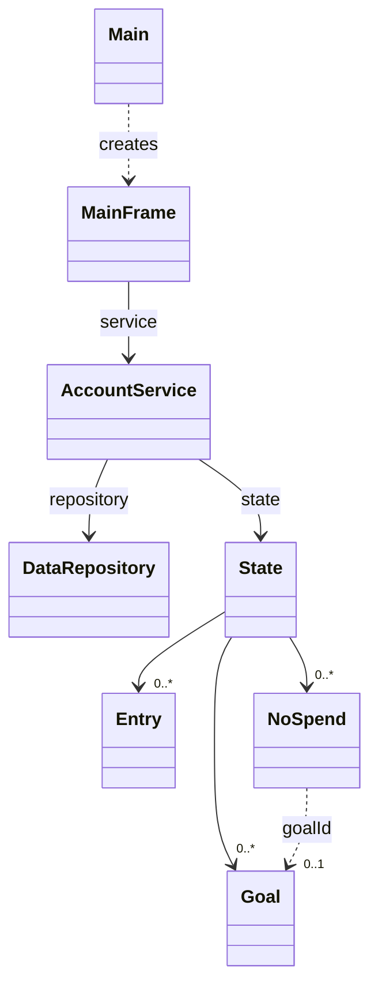

# 프로그램 구조와 처리 흐름

화면은 `MainFrame`, 기능 처리와 계산은 `AccountService`, 파일 읽기와 저장은 `DataRepository`가 담당합니다. CP3에서 기능별로 나눠 설계했던 서비스는 베타 구현에서 하나의 `AccountService`에 모았습니다.

## 클래스 관계

아래 그림은 주요 클래스 사이의 관계를 간략히 표시한 것입니다. `Domain` 안의 데이터 클래스는 별도 상자로 표시했고, 생성자와 getter는 생략했습니다. 편집용 원본은 [class-diagram.mmd](class-diagram.mmd)에 있습니다.



`State`에는 거래 목록, 월별 예산, 목표 목록, 꾹참기 목록과 기록 시작 월이 들어 있습니다. `NoSpend`는 목표 객체를 직접 보관하지 않고 선택한 목표의 ID를 보관합니다. 목표를 선택하지 않았다면 `goalId`는 `null`입니다.

## 대표 함수

| 함수 | 입력 | 반환값과 역할 |
|---|---|---|
| `manageTransaction` | `TransactionCommand` | 거래를 추가·수정·삭제하거나 조건에 맞는 `List<Entry>` 반환 |
| `manageMonthlyFinance` | `BudgetCommand` | 월 예산 설정 또는 수입·지출·잔액 등의 `Summary` 반환 |
| `analyzeSpending` | 조회 월, 선택적 카테고리와 절감률 | 소비 통계와 절감 예상액을 담은 `Analysis` 반환 |
| `manageGoal` | `GoalCommand` | 목표 처리 후 `List<GoalStatus>` 반환 |
| `manageNoSpend` | `NoSpendCommand` | 조회 결과 또는 처리한 한 건을 담은 `List<NoSpend>` 반환 |

입력용 Command에는 처리 종류와 필요한 값이 들어 있습니다. 예를 들어 거래 추가는 `CREATE`, 수정은 `UPDATE`, 삭제는 `DELETE`, 조회는 `QUERY`를 사용합니다. 입력이 잘못되었거나 저장에 실패하면 `AppException`이 발생하고 화면에서 안내합니다.

## 거래 추가 흐름

1. 사용자가 거래 추가 버튼을 누르면 `MainFrame`이 입력창을 엽니다.
2. 입력값으로 `TransactionCommand`를 만들어 `manageTransaction`을 호출합니다.
3. 서비스가 날짜, 유형, 카테고리와 금액을 검사하고 새 `Entry`를 만듭니다.
4. 거래가 추가된 다음 `State`를 만들어 저장소에 전달합니다.
5. 파일 저장에 성공하면 서비스의 현재 상태를 바꾸고 화면에서 목록과 합계를 갱신합니다.

서비스의 저장 순서는 다음과 같습니다.

```java
private void save(State next) {
    repository.commit(next);
    state = next;
}
```

`commit`에서 예외가 발생하면 현재 메모리 상태도 바꾸지 않습니다. 저장소는 같은 폴더의 임시 파일에 기록한 뒤 원자적 교체로 원본을 바꿉니다. 원자적 교체를 지원하지 않는 환경에서는 오류를 반환합니다. 같은 데이터 파일을 여러 프로그램에서 동시에 사용하지 못하도록 파일 잠금도 사용합니다.

## 꾹참기와 실제 저축

꾹참기는 실제 거래와 별도로 관리합니다. 구매를 참았다고 기록하는 것만으로 수입이나 실제 저축액이 증가하지 않습니다.

| 작업 | 처리 |
|---|---|
| `REGISTER` | 가상 절약 기록 생성. 목표 연결은 선택 사항이며 `applied=false`로 시작 |
| `LINK_GOAL` | 목표가 없고 실제 반영 전인 기록에 목표 연결 |
| `APPLY_ACTUAL` | 연결한 목표의 실제 저축액에 기록 전액을 더하고 `applied=true`로 변경 |

이미 반영한 기록을 다시 처리하면 `ALREADY_APPLIED` 오류를 반환합니다. 목표가 없으면 `GOAL_REQUIRED` 오류를 반환합니다. 이 검사는 버튼 상태와 별도로 서비스에서도 수행합니다. 목표의 저축액과 기록의 반영 여부는 하나의 상태로 함께 저장합니다.

예를 들어 목표액 2,000,000원, 실제 저축액 500,000원일 때 꾹참기 30,000원을 등록하면 실제 달성률은 25% 그대로이고 가상 진척도는 1.5%입니다. 실제 반영을 확인하면 저축액은 530,000원, 실제 달성률은 26.5%가 됩니다. 가상 기록은 유지하지만 실제 저축액에 다시 합산하지 않습니다.

목표를 삭제하면 꾹참기 기록은 남기고 목표 연결만 해제합니다. 이미 반영한 기록의 `applied` 값도 유지하므로 다른 목표에 재반영할 수 없습니다.

## 계산 기준

- 월간 잔액: 선택 월의 수입 − 지출. 은행 계좌 전체 잔액을 뜻하지 않습니다.
- 예산 사용률: 월 지출 ÷ 월 예산 × 100. 예산이 없으면 관련 지표는 미설정으로 표시합니다.
- 현재 월 예상 지출: 현재까지의 지출 ÷ 경과 일수 × 월 전체 일수. 과거 월은 최종 지출을 사용합니다.
- 소비 비교: 선택 월을 제외한 직전 3개월 중 기록 시작 월 이후의 월을 사용합니다. 유효한 비교 월에 지출이 없어도 0원으로 평균에 포함합니다.
- 절감액: 선택 카테고리의 해당 월 지출 × 절감률. 연간 예상액은 월간 절감액 × 12입니다. 함수에 전달하는 20%는 `0.20`입니다.
- 목표 달성률: 실제 저축액 ÷ 목표액 × 100. 가상 진척도는 연결한 꾹참기 금액으로 별도 계산합니다.

금액 계산에는 `BigDecimal`을 사용합니다. 입력 금액은 정수 원으로 제한하고, 계산 결과는 화면에 표시할 때 반올림합니다.

## 검사와 API 문서

`ServiceTest`는 별도 테스트 라이브러리 없이 실행합니다. 계산 결과, 거래 검색과 CRUD, 파일 재로딩, 저장 실패 시 상태 유지, 손상 파일 보존, 중복 반영과 동시 요청 등을 검사합니다. 현재 60개 확인 항목이 있습니다.

빌드 스크립트는 소스의 Javadoc 주석으로 HTML API 문서도 생성합니다. 생성된 `docs/api/index.html`에서 클래스 설명과 `@param`, `@return`, `@throws`에 작성한 내용을 확인할 수 있습니다.
